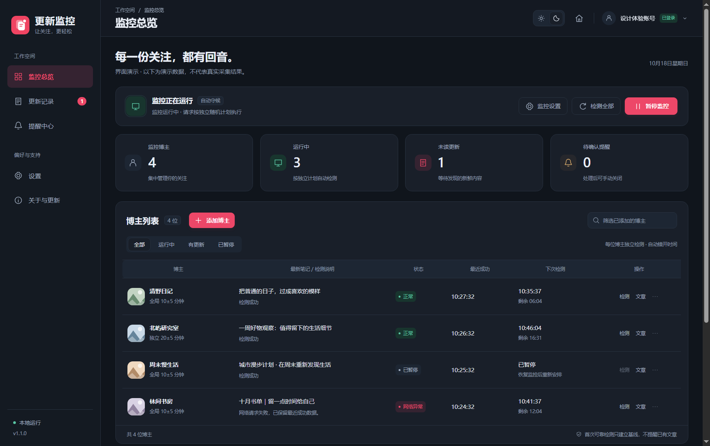
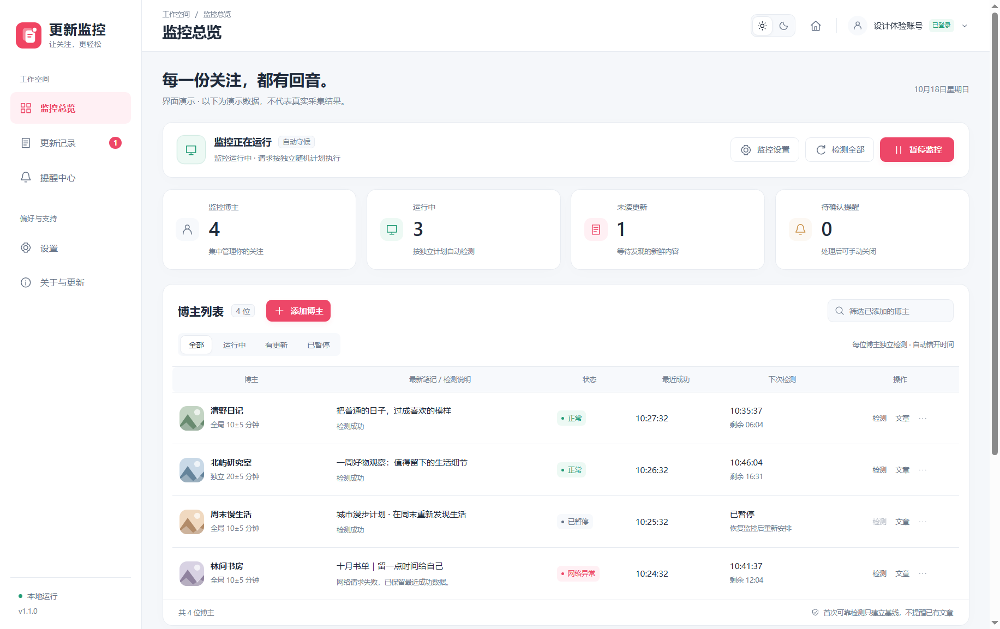
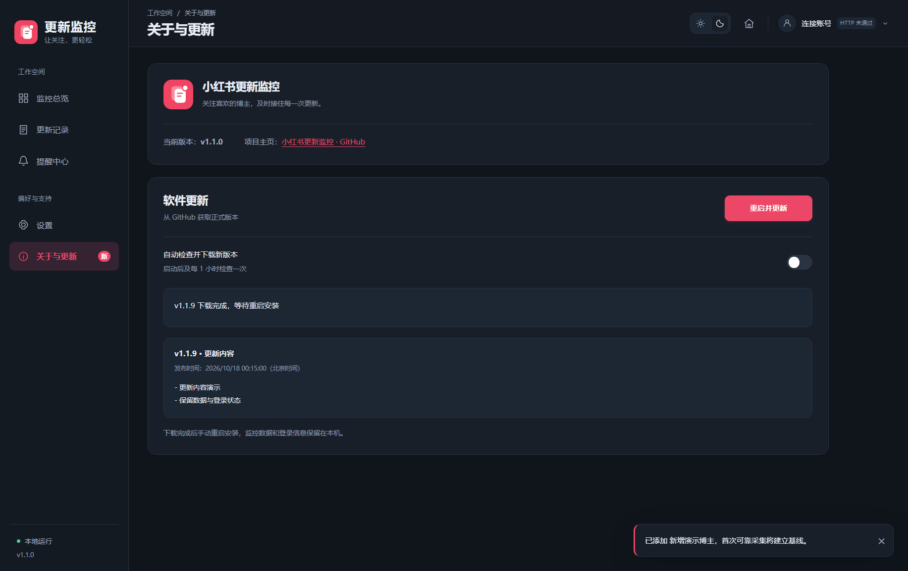

<p align="center"></p>

# 小红书更新监控 · XHS Update Monitor

一个运行在 Windows 上的小红书多博主更新监控面板。添加你关注的博主主页，设置检测间隔，发现新笔记后用弹窗和提示音提醒，减少反复打开主页查看的操作。

**当前版本：v1.1.0。** 前往 [GitHub Releases](https://github.com/qinrz2002/xhs-update-monitor/releases/latest) 下载 Windows 安装包。每次更新内容与北京时间记录在 [更新日志](CHANGELOG.md)。

**免责声明：本项目仅供学习与技术研究，请勿用于任何非法用途。** 使用时请遵守适用法律法规及平台规则，尊重他人隐私与合法权益。完整说明见 [免责声明](DISCLAIMER.md)。

## 可以做什么

- **多个博主统一管理**：通过主页或分享链接添加，读取昵称和头像，支持编辑、暂停、删除。
- **名称搜索添加**：用curl查询官方用户搜索接口，返回昵称和头像；打开候选主页核对后再确认添加。
- **自定义检测间隔**：设置基础时间与随机浮动，每位博主独立排程。例如10分钟±5分钟，每轮在5～15分钟内随机安排。
- **新笔记提醒**：更新记录、Windows通知和应用提醒窗；开启循环提示音后，需手动关闭提醒才停止。
- **文章列表**：查看已读取的标题和链接，交给系统默认浏览器打开原文。
- **交互工作台**：全宽博主列表、本地筛选、可点击统计卡、更多菜单、侧边设置与账号菜单，常用操作集中呈现。
- **状态动效**：页面与抽屉自然过渡，搜索和检测展示加载反馈，支持键盘操作和系统减少动画偏好。
- **亮暗主题**：手动切换并记住上次选择；关闭主窗口后可在托盘继续运行。
- **本地保存**：设置与记录使用JSON，数据保存在程序旁的data文件夹；登录信息在本机加密保存。
- **版本更新**：安装版启动后及每1小时检查GitHub正式Release，发现新版自动下载，完成后由你手动重启安装。
- **更新说明**：发现新版时显示红色提示和应用内确认框，弹窗及“关于与更新”均展示更新内容与发布时间；可选择稍后更新。

## 界面预览

截图使用独立的演示数据，不含真实登录账号、Cookie或用户监控记录。

### 监控总览 · 暗色



### 监控总览 · 亮色



### 关于项目与软件更新

版本和项目主页、更新设置分别放在独立卡片中。



## 界面怎么用

| 入口 | 用途 |
| --- | --- |
| 监控总览 | 管理博主、手动检测、设置检测间隔和提醒 |
| 更新记录 | 查看新发现的笔记，标记已读、打开原文 |
| 提醒中心 | 查看并手动关闭当前提醒；查看文章不会自动静音 |
| 设置 | 管理扫码登录选项、查看数据位置、退出应用 |
| 关于与更新 | 查看版本及项目主页，检查、下载和安装新版 |

## 第一次使用

1. 安装并打开软件，通过右上角账号菜单打开登录窗口扫码，再点击“验证会话”。
2. 点击“博主列表”右侧“添加博主”，粘贴主页链接读取信息，或切换到名称搜索，打开候选主页核对后确认。
3. 点击“监控设置”打开侧边抽屉，设置基础检测间隔与随机浮动，选择是否开启Windows通知和循环提示音。
4. 点击“开始监控”。首次可靠检测建立基线，已有笔记不会当成新文章提醒。
5. 新笔记会进入更新记录；需要停止声音时，在提醒中心手动关闭提醒。

关闭窗口会隐藏到托盘。需要完全停止时，请从设置或托盘选择“退出应用”。

## 当前范围

日常采集通过curl读取主页源代码，不自动逐篇打开文章详情。主页通常只提供近期笔记，因此文章列表不等于完整历史；页面不足或遇到登录、安全验证、平台限制时会保留上次结果并提示。

名称搜索通过curl请求官方用户搜索接口，已通过真实线上验收；候选主页由用户打开核对。随机间隔只用于错开请求，不保证避免平台访问限制。

## 数据与备份

设置、博主和历史记录位于当前程序exe同级的data文件夹，实际路径可在设置页查看。退出软件后备份整个data目录；迁移时请连同data一起保留。加密会话受当前Windows账户保护，不保证可跨账户或跨电脑直接复用。

本项目与小红书官方没有关联，采集能力取决于官方页面实际返回的数据。

## 源码运行与构建

需要 Windows、Node.js 24 和 pnpm 11。

```cmd
pnpm install --frozen-lockfile --ignore-scripts
node node_modules/electron/install.js
pnpm start
```

运行 `pnpm test` 执行业务测试，运行 `pnpm package` 构建 Windows 安装器。构建产物位于 `release/installer`。请勿将本机 `data`、Cookie或加密登录态提交到仓库。第三方组件信息见 [组件说明](THIRD_PARTY_NOTICES.md)。

## 发布新版本

1. 修改 `package.json` 版本号，并在 `docs/releases.json` 顶部新增该版本的 `changes` 更新内容，`publishedAt` 先填 `null`。
2. 运行 `node scripts/release-notes.cjs` 生成更新日志和发布说明，执行测试并提交到 main。
3. 推送同名版本标签（例如 `v1.1.0`），GitHub Actions 会校验更新内容、构建并发布正式版本。
4. 正式发布后，流程以 GitHub 的实际 `published_at` 自动填写 Release 说明、`CHANGELOG.md` 与版本记录，统一显示北京时间，保留历史版本记录。
